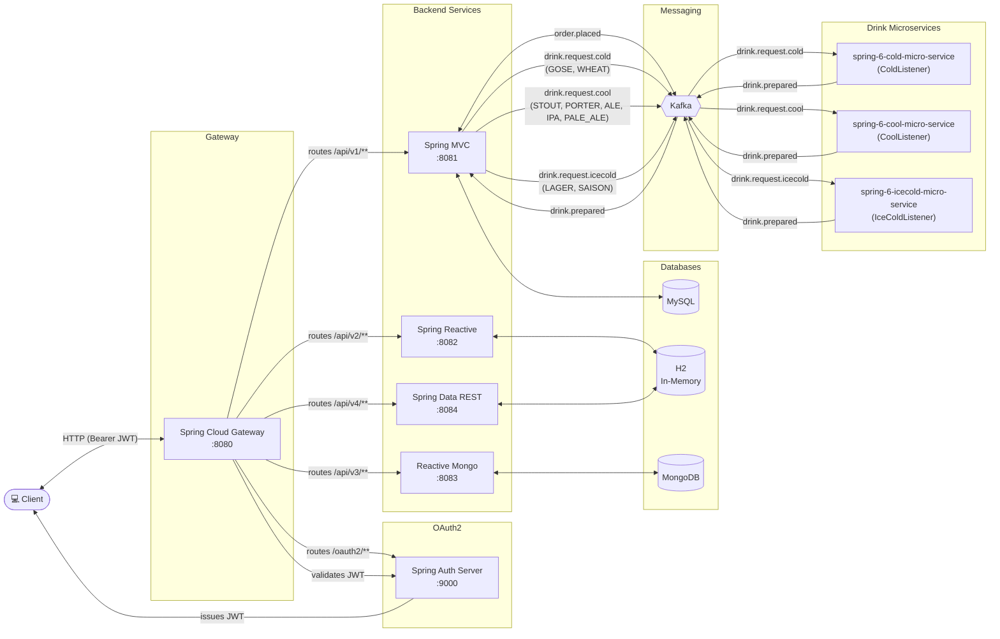

# spring-6-gateway

Spring Cloud Gateway (WebFlux) that routes requests to the sibling Spring 6 services
(auth-server, rest-mvc, reactive, reactive-mongo, data-rest) and validates JWT bearer tokens.

## Getting started

Server runs on port 8080. Requires that other projects are up and running.
* spring-6-auth-server on port 9000
* spring-6-rest-mvc on port 8081
* spring-6-reactive on port 8082
* spring-6-reactive-mongo on port 8083
* spring-6-data-rest on port 8084
Example requests can be found in the `restRequests/` directory, grouped per upstream service
(`mvc/`, `reactive/`, `reactive-mongo/`, `data-rest/`).

## Urls

* openapi:
  * http://localhost:8080/swagger-ui/index.html
  * http://localhost:30080/swagger-ui/index.html
* actuator: http://localhost:8080/actuator/info

## Architecture Overview



## Sandbox (local dev environment)

The sandbox consists of the gateway (Spring Boot, port 8080) plus the upstream projects
(auth-server on port 9000, rest-mvc, reactive, reactive-mongo, data-rest) provided via `compose.yaml`
and the IntelliJ run configurations.

> **Workaround (Windows): `host.docker.internal` must resolve to `127.0.0.1`.**
> The gateway runs as a host JVM (unit/IT tests, `./mvnw spring-boot:run`), while the upstream
> services run as Docker containers. Their OAuth2 JWT issuer is `http://host.docker.internal:9000`,
> so the gateway must resolve that name too. Docker Desktop writes it to your `hosts` file — but
> often on your LAN IP (e.g. `192.168.178.124`), where the mapped port is not reachable (timeout).
> Fix: in `C:\Windows\System32\drivers\etc\hosts` (admin Notepad), map both names to loopback —
> and place the entries **before** the `# Added by Docker Desktop` block (first match wins), so a
> Docker-managed rewrite cannot override them:
>
> ```
> 127.0.0.1 host.docker.internal
> 127.0.0.1 gateway.docker.internal
>
> # Added by Docker Desktop
> #192.168.178.124 host.docker.internal
> #192.168.178.124 gateway.docker.internal
> 127.0.0.1 kubernetes.docker.internal
> # End of section
> ```
>
> Then flush the DNS cache:
>
> ```powershell
> ipconfig /flushdns
> ```
>
> In Docker Desktop Settings, disable
> "Add the *.docker.internal names to the host's /etc/hosts file" — note this does **not** remove
> already written entries, so fix them as above.
>
> **CI:** the build workflow (`maven-build.yml`) solves the same problem on Linux by appending
> `127.0.0.1 host.docker.internal` to `/etc/hosts` in each job before running Maven.

### Start the sandbox (opencode-sandbox-kit)

The sandbox is provisioned by the opencode-sandbox-kit and runs as a Docker container. It mounts this
repo, starts opencode, and connects the IntelliJ MCP server.

Allow the kit source (Codeberg without cloning):

```powershell
sbx settings set kit.allowedSources --% "[\"docker.io/\",\"codeberg.org/dboeckli/\"]"
```

Start a new sandbox:

```powershell
sbx run opencode `
    --kit "git+https://codeberg.org/dboeckli/opencode-sandbox-kit.git#dir=opencode-agent" `
    --template docker.io/domboeckli/sbx-opencode-tooling:latest `
    --skills=off `
    --static-mcp idea,k8s,docker `
    . `
    "C:\development\maven-repo:ro"
```

### Observability (ELK)

The gateway and the upstream services export telemetry (traces, metrics, logs) to the ELK stack over
OTLP via the OpenTelemetry collector. Start the opt-in `observability` compose profile:

```bash
docker compose --profile observability up -d
```

GUIs / endpoints (from the host):

- **Kibana UI:** <http://localhost:5601> (APM traces, Discover, logs)
- Elasticsearch: <http://localhost:9200>
- APM Server (OTLP HTTP intake): <http://localhost:8200>
- OTel Collector OTLP intake: gRPC `:4317`, HTTP `:4318`

### Deployment with Helm

Be aware that we are using a different namespace here (not default).

Go to the directory where the tgz file has been created after 'mvn install'

```powershell
cd target/helm/repo
```

unpack

```powershell
$file = Get-ChildItem -Filter spring-6-gateway-chart-*.tgz | Select-Object -First 1
tar -xvf $file.Name
```

install

```powershell
$APPLICATION_NAME = Get-ChildItem -Directory | Where-Object { $_.LastWriteTime -ge $file.LastWriteTime } | Select-Object -ExpandProperty Name
helm upgrade --install $APPLICATION_NAME ./$APPLICATION_NAME --namespace spring-6-gateway --create-namespace --wait --timeout 8m --debug --render-subchart-notes
```

show logs and show event

```powershell
kubectl get pods -n spring-6-gateway
```

replace $POD with pods from the command above

```powershell
kubectl logs $POD -n spring-6-gateway --all-containers
```

Show Details and Event

$POD_NAME can be: spring-6-gateway, spring-6-reactive-mongo-mongodb or spring-6-rest-mvc-mysql

```powershell
kubectl describe pod $POD_NAME -n spring-6-gateway
```

Show Endpoints

```powershell
kubectl get endpoints -n spring-6-gateway
```

test

```powershell
helm test $APPLICATION_NAME --namespace spring-6-gateway --logs
```

status

```powershell
helm status $APPLICATION_NAME --namespace spring-6-gateway
```

uninstall

```powershell
helm uninstall $APPLICATION_NAME --namespace spring-6-gateway
```

delete all

```powershell
kubectl delete all --all -n spring-6-gateway
```

create busybox sidecar

```powershell
kubectl run busybox-test --rm -it --image=busybox:1.36 --namespace=spring-6-gateway --command -- sh
```

You can use the actuator rest call to verify via port 30080
