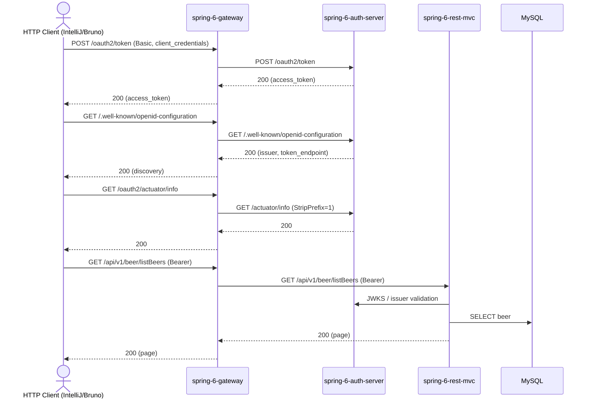

# Auth-Server Flow: token → discovery → actuator → protected call

Datei: `restRequests/auth-server/token-flow/token-flow.http`

## Ziel

Den Auth-Server über das Gateway prüfen: Client-Credentials-Token holen, Discovery und Actuator
abarbeiten und anschließend mit dem Token einen geschützten Service aufrufen. Der Flow verwendet
denselben Gateway-Port wie die Service-Flows (`{{gateway-port}}`).

## Ablauf (Services)

## Requests (in dieser Reihenfolge)

1. `get an access token` – `POST /oauth2/token` über das Gateway, Basic Auth
   `messaging-client`/`secret`, Scope `message.read message.write`; speichert `accessToken`.
2. `discovery` – `GET /.well-known/openid-configuration`; prüft `token_endpoint` und Issuer.
3. `actuator` – `GET /oauth2/actuator/info` über das Gateway (`StripPrefix=1`).
4. `protected call` – `GET /api/v1/beer/listBeers` mit `Bearer {{accessToken}}`; prüft `content`.

## Benötigte Globals

|    Global     |      gesetzt von      |   genutzt von    |
|---------------|-----------------------|------------------|
| `accessToken` | `get an access token` | `protected call` |

## Asserts

- Token → `200`, `access_token` vorhanden.
- Discovery → `200`, `token_endpoint` vorhanden, Issuer enthält den Auth-Server-Port `9000`.
- Actuator → `200`.
- Protected Call → `200`, `content` vorhanden.

## Hinweise

- Basis-URL ist `{{gateway-port}}` (`local` = 8080, `k8s` = 30080).
- Der Token-Request nutzt die IntelliJ-Kurzform `Authorization: Basic messaging-client secret`.
  IntelliJ kodiert das automatisch; der Bruno-Konverter erzeugt daraus den korrekten
  `Authorization: Basic <base64>`-Header.
- Der geschützte Aufruf geht an `spring-6-rest-mvc` (`/api/v1/**`), das den JWT gegen den
  Auth-Server validiert.
- UserInfo ist **nicht** Teil dieses Flows: Ein Client-Credentials-Token mit `openid`-Scope wird
  vom Auth-Server mit `401 invalid_token` abgelehnt; UserInfo benötigt ein Authorization-Code-Token.
- Die Sammlung `restRequests/AuthServerRequest.http` bleibt die Utility-Sammlung für die
  verschiedenen Token-/Discovery-/Actuator-Varianten (localhost, host.docker.internal, Gateway).

