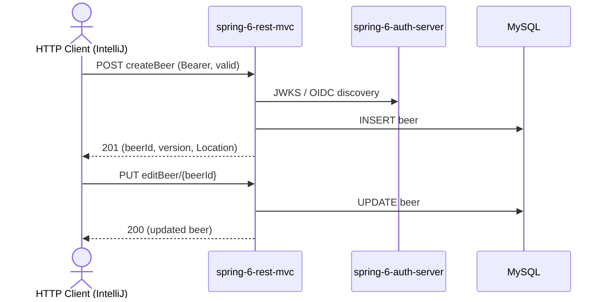

# beer Flow: createBeer → editBeer

Datei: `restRequest/beer-flow-create-edit/beer-flow-create-edit.http`

## Ziel

Ein neues Bier anlegen und dieses anschließend vollständig bearbeiten (PUT).

## Ablauf (Services)

## Requests (in dieser Reihenfolge)

1. `createBeer` – legt ein Bier an, speichert `beerId` **und** `beerVersion`.
2. `editBeer` – vollständiges Update (PUT) dieser Order; schickt die zuvor gespeicherte `beerVersion` mit.

## Benötigte Globals

|       Global        |          gesetzt von           |            genutzt von            |
|---------------------|--------------------------------|-----------------------------------|
| `beerId`            | `createBeer`                   | `editBeer`                        |
| `beerVersion`       | `createBeer`                   | `editBeer` (optimistic lock)      |
| `traceId`, `spanId` | `../../scripts/traceparent.js` | alle Requests (Trace-Korrelation) |

## Asserts

- `createBeer` → `201`, `id` gesetzt, `beerName` = `presidente`.
- `editBeer` → `200`, `beerName` = `presidente-edited`.

## Hinweise

- Basis-URL ist `{{gateway-port}}` (Profil `local` = 8081, `k8s` = 30081).
- `createBeer`/`editBeer` sind `@Validated`: `beerName`, `beerStyle`, `upc` und `price` müssen gesetzt (nicht leer) sein,
  sonst `400`. Deshalb hat der `editBeer`-Body eine gültige (`nicht-leere`) `upc`.
- Die `beerVersion` wird aus der Create-Antwort übernommen, damit das optimistische Locking (`@Version`) beim Update passt.
- Schreiboperationen lösen Spring-Events (`BeerCreatedEvent`/`BeerUpdateEvent`) aus → `BeerCreatedListener` schreibt einen
  `BeerAudit`-Eintrag.

