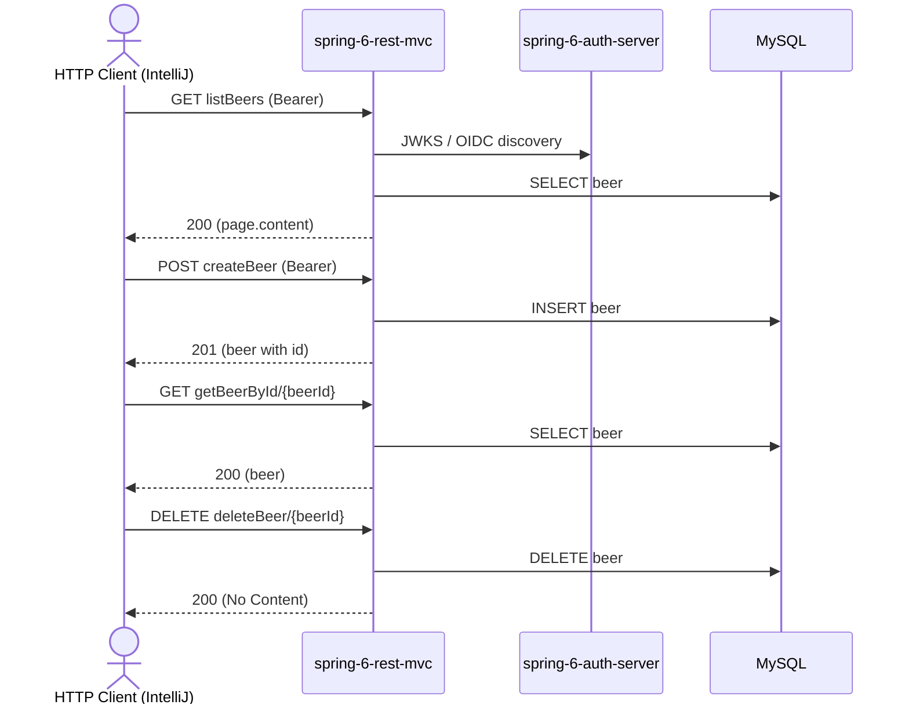

# beer Flow: listBeers → createBeer → getBeerById → deleteBeer

Datei: `restRequest/beer-flow-list-get-delete/beer-flow-list-get-delete.http`

## Ziel

Die Liste abrufen und anschließend ein **eigens angelegtes** Bier holen und löschen.

Das Bier wird bewusst im Flow erzeugt, statt ein Bier aus der Seed-Liste zu löschen: Seed-Biere
können über `beer_order_line` referenziert sein, wodurch das Löschen mit `409 Conflict`
fehlschlägt. Ein selbst angelegtes Bier ist nie referenziert und damit deterministisch löschbar.

## Ablauf (Services)

## Requests (in dieser Reihenfolge)

1. `listBeers` – prüft den Listen-Endpunkt (`200`); setzt bewusst keine `beerId`.
2. `createBeer` – legt ein dediziertes Bier für den Delete-Teil an und speichert `beerId`.
3. `getBeerById` – holt das Bier per `beerId`.
4. `deleteBeer` – löscht genau dieses selbst angelegte Bier per `beerId`.

## Benötigte Globals

|       Global        |          gesetzt von           |            genutzt von            |
|---------------------|--------------------------------|-----------------------------------|
| `beerId`            | `createBeer`                   | `getBeerById`, `deleteBeer`       |
| `traceId`, `spanId` | `../../scripts/traceparent.js` | alle Requests (Trace-Korrelation) |

## Asserts

- `listBeers` → `200`.
- `createBeer` → `201` mit `id`.
- `getBeerById` → `200`, `id` entspricht der `{{beerId}}`.
- `deleteBeer` → `200`.

## Hinweise

- Basis-URL ist `{{gateway-port}}` (Profil `local` = 8081, `k8s` = 30081).
- `listBeers` liefert eine `Page`; das erste Element liegt unter `response.body.content[0]`.
- `getBeerById` liefert `404 Not Found`, wenn das Bier nicht existiert.
- `deleteBeer` liefert `200 OK` (leerer Body) und `404 Not Found`, wenn das Bier nicht existiert.
- `deleteBeer` liefert `409 Conflict`, wenn das Bier noch von einer Beer Order referenziert wird –
  deshalb wird hier ein eigenes Bier gelöscht.

