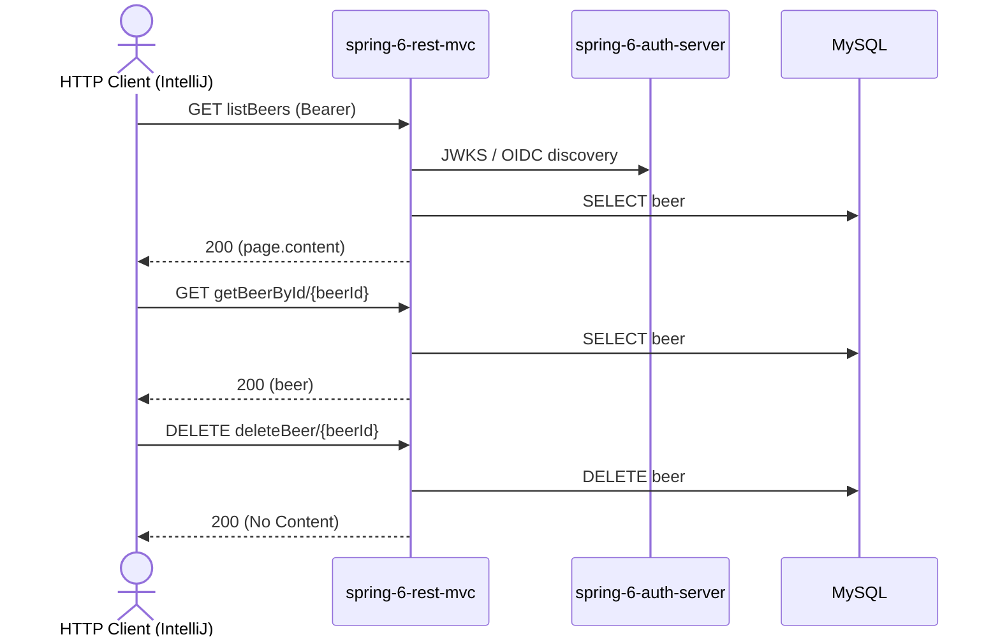

# beer Flow: listBeers → getBeerById → deleteBeer

Datei: `restRequest/beer-flow-list-get-delete/beer-flow-list-get-delete.http`

## Ziel

Ein Bier aus der Liste holen und anschließend löschen.

## Ablauf (Services)

## Requests (in dieser Reihenfolge)

1. `listBeers` – speichert `beerId` (erstes Bier aus `content`).
2. `getBeerById` – holt das Bier per `beerId`; das Pre-Request-Skript loggt die benutzte `beerId` und wirft einen Fehler,
   wenn sie nicht gesetzt ist.
3. `deleteBeer` – löscht das Bier per `beerId`.

## Benötigte Globals

|       Global        |          gesetzt von           |            genutzt von            |
|---------------------|--------------------------------|-----------------------------------|
| `beerId`            | `listBeers`                    | `getBeerById`, `deleteBeer`       |
| `traceId`, `spanId` | `../../scripts/traceparent.js` | alle Requests (Trace-Korrelation) |

## Asserts

- `listBeers` → `200`.
- `getBeerById` → `200`, `id` entspricht der `{{beerId}}`.
- `deleteBeer` → `200`.

## Hinweise

- Basis-URL ist `{{gateway-port}}` (Profil `local` = 8081, `k8s` = 30081).
- `listBeers` liefert eine `Page`; das erste Element liegt unter `response.body.content[0]`.
- Ohne vorheriges `listBeers` ist `beerId` leer → das `getBeerById`-Pre-Request wirft einen Fehler.
- `getBeerById` liefert `404 Not Found`, wenn das Bier nicht existiert.
- `deleteBeer` liefert `200 OK` (leerer Body), `404 Not Found`, wenn das Bier nicht existiert.

