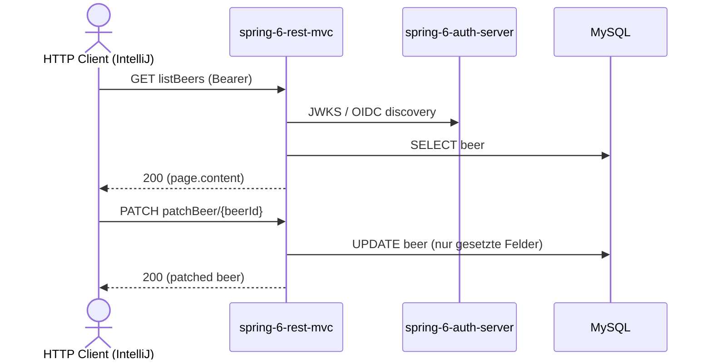

# beer Flow: listBeers → patchBeer

Datei: `restRequest/beer-flow-list-patch/beer-flow-list-patch.http`

## Ziel

Ein bestehendes Bier aus der Liste auswählen und partiell aktualisieren (PATCH).

## Ablauf (Services)

## Requests (in dieser Reihenfolge)

1. `listBeers` – speichert `beerId` (erstes Bier aus `content`).
2. `patchBeer` – setzt nur `beerName`; alle anderen Felder bleiben unverändert.

## Benötigte Globals

|       Global        |          gesetzt von           |  genutzt von  |
|---------------------|--------------------------------|---------------|
| `beerId`            | `listBeers`                    | `patchBeer`   |
| `traceId`, `spanId` | `../../scripts/traceparent.js` | alle Requests |

## Asserts

- `patchBeer` → `200`, `beerName` = `patched-beername`.

## Hinweise

- Basis-URL ist `{{application-port}}` (Profil `local` = 8081, `k8s` = 30081).
- `patchBeer` ist **nicht** `@Validated` – nur die im Body gesetzten Felder werden übernommen (partielle Änderung).
- Ohne vorheriges `listBeers` ist `beerId` leer → das `patchBeer`-Pre-Request wirft einen Fehler.
- PATCH löst ein `BeerPatchEvent` aus → `BeerCreatedListener` schreibt einen `BeerAudit`-Eintrag.

