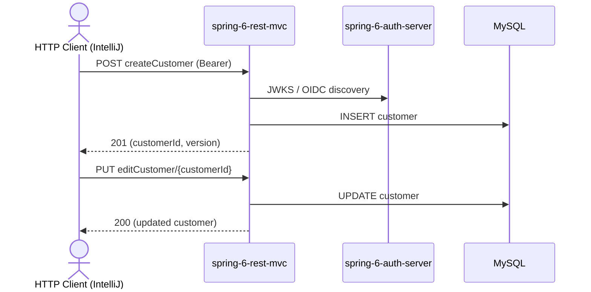

# customer Flow: createCustomer → editCustomer

Datei: `restRequest/customer-flow-create-edit/customer-flow-create-edit.http`

## Ziel

Einen neuen Kunden anlegen und diesen anschließend vollständig bearbeiten (PUT).

## Ablauf (Services)

## Requests (in dieser Reihenfolge)

1. `createCustomer` – legt einen Kunden an, speichert `customerId` **und** `customerVersion`.
2. `editCustomer` – vollständiges Update (PUT); schickt die zuvor gespeicherte `customerVersion` mit.

## Benötigte Globals

|       Global        |          gesetzt von           |            genutzt von            |
|---------------------|--------------------------------|-----------------------------------|
| `customerId`        | `createCustomer`               | `editCustomer`                    |
| `customerVersion`   | `createCustomer`               | `editCustomer` (optimistic lock)  |
| `traceId`, `spanId` | `../../scripts/traceparent.js` | alle Requests (Trace-Korrelation) |

## Asserts

- `createCustomer` → `201`, `id` gesetzt, `name` = `customer-flow`.
- `editCustomer` → `200`, `name` = `customer-flow-edited`.

## Hinweise

- Basis-URL ist `{{application-port}}` (Profil `local` = 8081, `k8s` = 30081).
- `CustomerDTO` hat das Feld **`name`** (nicht `customerName`) und `version` als **String**.
- Die `customerVersion` wird aus der Create-Antwort übernommen, damit das optimistische Locking (`@Version`) beim Update passt.
- Der Name im Edit-Body ist bewusst gesetzt; `editCustomer` prüft nur, ob die Line existiert.

