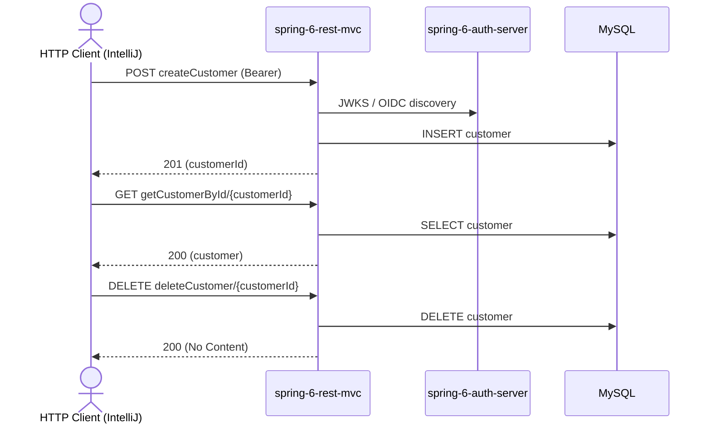

# customer Flow: createCustomer → getCustomerById → deleteCustomer

Datei: `restRequests/mvc/customer-flow-create-get-delete/customer-flow-create-get-delete.http`

## Ziel

Einen frischen Kunden anlegen, holen und wieder löschen — deterministisch, ohne FK-Konflikt.

## Ablauf (Services)

## Requests (in dieser Reihenfolge)

1. `createCustomer` – legt einen frischen Kunden an, speichert `customerId`.
2. `getCustomerById` – holt den Kunden per `customerId`; das Pre-Request-Skript prüft, dass `customerId` gesetzt ist.
3. `deleteCustomer` – löscht den Kunden per `customerId`.

## Benötigte Globals

|       Global        |          gesetzt von           |             genutzt von             |
|---------------------|--------------------------------|-------------------------------------|
| `customerId`        | `createCustomer`               | `getCustomerById`, `deleteCustomer` |
| `traceId`, `spanId` | `../../scripts/traceparent.js` | alle Requests                       |

## Asserts

- `createCustomer` → `201`, `id` gesetzt, `name` = `customer-flow`.
- `getCustomerById` → `200`, `id` entspricht der `{{customerId}}`.
- `deleteCustomer` → `200`.

## Hinweise

- Basis-URL ist `{{gateway-port}}` (Profil `local` = 8081, `k8s` = 30081).
- Ein **frisch angelegter** Kunde hat keine Bestellungen (`beer_order.customer_id → customer.id`), daher ist das Löschen nicht durch einen FK blockiert.
- Einen Kunden **mit** Bestellungen zu löschen liefert jetzt `409 Conflict` (statt `500`), siehe `ExceptionHandlerController` (`DataIntegrityViolationException`).
- `getCustomerById` liefert `404 Not Found`, wenn der Kunde nicht existiert.
- `deleteCustomer` liefert `200 OK` (leerer Body), `404 Not Found`, wenn der Kunde nicht existiert.

