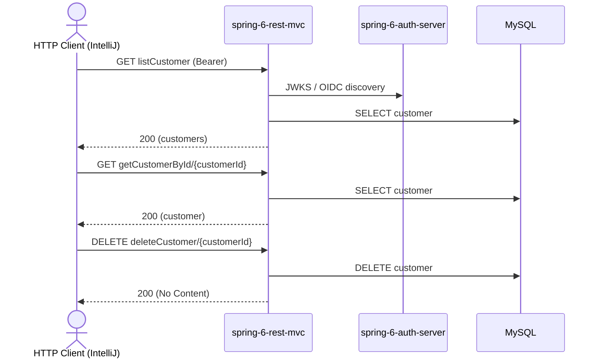

# customer Flow: listCustomer → getCustomerById → deleteCustomer

Datei: `restRequest/customer-flow-list-get-delete/customer-flow-list-get-delete.http`

## Ziel

Einen Kunden aus der Liste holen und anschließend löschen.

## Ablauf (Services)

## Requests (in dieser Reihenfolge)

1. `listCustomer` – speichert `customerId` (erster Kunde aus der Liste).
2. `getCustomerById` – holt den Kunden per `customerId`; das Pre-Request-Skript loggt die benutzte `customerId` und wirft
   einen Fehler, wenn sie nicht gesetzt ist.
3. `deleteCustomer` – löscht den Kunden per `customerId`.

## Benötigte Globals

|       Global        |          gesetzt von           |             genutzt von             |
|---------------------|--------------------------------|-------------------------------------|
| `customerId`        | `listCustomer`                 | `getCustomerById`, `deleteCustomer` |
| `traceId`, `spanId` | `../../scripts/traceparent.js` | alle Requests (Trace-Korrelation)   |

## Asserts

- `listCustomer` → `200`.
- `getCustomerById` → `200`, `id` entspricht der `{{customerId}}`.
- `deleteCustomer` → `200`.

## Hinweise

- Basis-URL ist `{{gateway-port}}` (Profil `local` = 8081, `k8s` = 30081).
- `listCustomer` liefert eine **List** (kein Page-Wrapper); das erste Element liegt unter `response.body[0]`.
- Ohne vorheriges `listCustomer` ist `customerId` leer → das `getCustomerById`-Pre-Request wirft einen Fehler.
- `getCustomerById` liefert `404 Not Found`, wenn der Kunde nicht existiert.
- `deleteCustomer` liefert `200 OK` (leerer Body), `404 Not Found`, wenn der Kunde nicht existiert.

