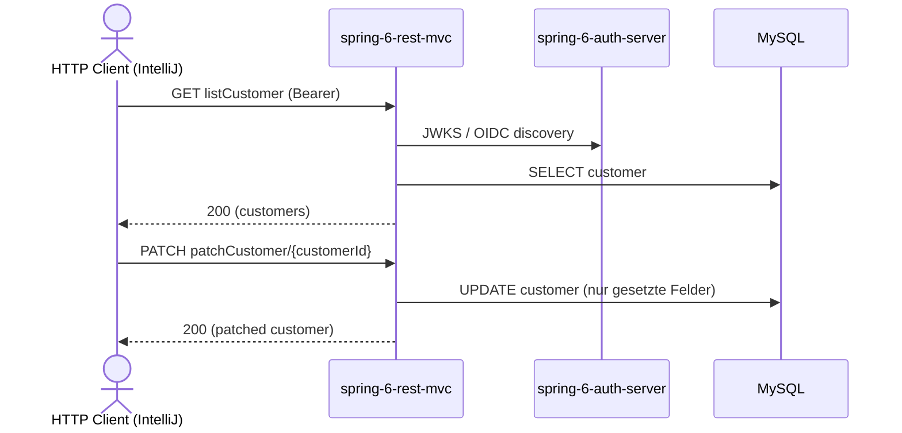

# customer Flow: listCustomer → patchCustomer

Datei: `restRequest/customer-flow-list-patch/customer-flow-list-patch.http`

## Ziel

Einen bestehenden Kunden aus der Liste auswählen und partiell aktualisieren (PATCH).

## Ablauf (Services)

## Requests (in dieser Reihenfolge)

1. `listCustomer` – speichert `customerId` (erster Kunde aus der Liste).
2. `patchCustomer` – setzt nur `name`; alle anderen Felder bleiben unverändert.

## Benötigte Globals

|       Global        |          gesetzt von           |   genutzt von   |
|---------------------|--------------------------------|-----------------|
| `customerId`        | `listCustomer`                 | `patchCustomer` |
| `traceId`, `spanId` | `../../scripts/traceparent.js` | alle Requests   |

## Asserts

- `patchCustomer` → `200`, `name` = `customer-flow-patched`.

## Hinweise

- Basis-URL ist `{{application-port}}` (Profil `local` = 8081, `k8s` = 30081).
- `patchCustomer` ist eine **`PATCH`**-Operation (`@PatchMapping`), nicht `PUT` (das alte Monolith-File nutzte hier fälschlich `PUT`).
- Nur die im Body gesetzten Felder werden übernommen (partielle Änderung).
- Ohne vorheriges `listCustomer` ist `customerId` leer → das `patchCustomer`-Pre-Request wirft einen Fehler.

