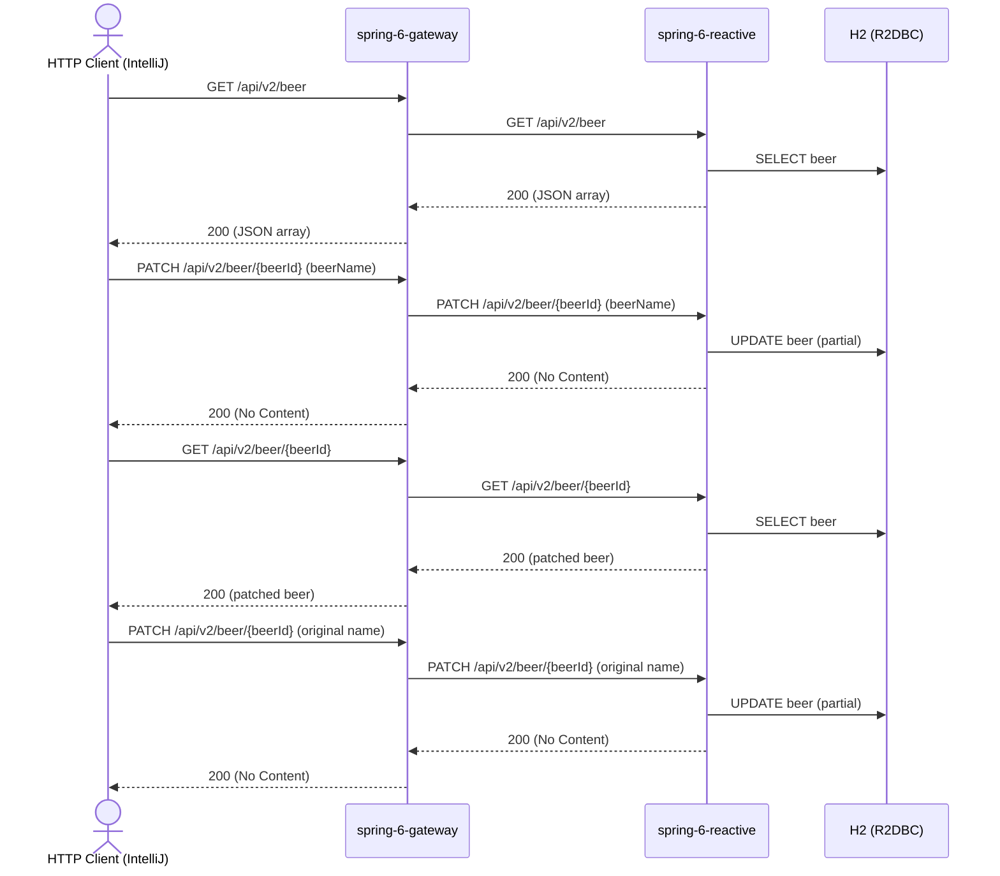

# beer Flow: listBeers → patchBeer → verify → restoreBeer

Datei: `restRequests/reactive/beer-flow-patch/beer-flow-patch.http`

## Ziel

Ein bestehendes Bier partiell aktualisieren (nur `beerName`), das Teilergebnis per GET prüfen und den ursprünglichen
Namen anschließend wiederherstellen – ohne das Bier zu löschen.

## Ablauf (Services)

## Requests (in dieser Reihenfolge)

1. `listBeers` – speichert `beerId`, `originalBeerName` und `originalBeerStyle` (erstes Bier aus dem JSON-Array).
2. `patchBeer` – partielles Update per PATCH; nur `beerName` wird gesendet.
3. `getBeerById` – prüft, dass `beerName` geändert und `beerStyle` unverändert ist.
4. `restoreBeer` – setzt den ursprünglichen `beerName` per PATCH zurück.

## Benötigte Globals

|                 Global                  |          gesetzt von           |         genutzt von          |
|-----------------------------------------|--------------------------------|------------------------------|
| `beerId`                                | `listBeers`                    | alle weiteren Requests       |
| `originalBeerName`, `originalBeerStyle` | `listBeers`                    | `getBeerById`, `restoreBeer` |
| `traceId`, `spanId`                     | `../../scripts/traceparent.js` | alle Requests                |

## Asserts

- `listBeers` → `200`, mindestens ein Bier.
- `patchBeer` → `200`.
- `getBeerById` → `200`, `beerName` = `Blessed Patched`, `beerStyle` unverändert.
- `restoreBeer` → `200`.

## Hinweise

- Basis-URL ist `{{gateway-port}}` (Profil `local` = 8080, `k8s` = 30080); der Gateway routet `/api/v2/**` an
  `spring-6-reactive` (Port 8082/30082).
- PATCH ist ein partielles Update: nur nicht-leere Felder (`beerName`, `beerStyle`, `upc`, `price`, `quantityOnHand`)
  werden übernommen; das Response-Body ist leer.
- Die Collection wird als JSON-Array geliefert (kein HAL, kein `_embedded`).
- Der Flow löscht kein Bier; Schritt 4 stellt den Ausgangszustand wieder her. Ohne Schritt 4 bleibt `Blessed Patched`
  gespeichert.
- Alle Requests benötigen ein Bearer-Token (`auth-id` aus `http-client.env.json`); dafür muss der Auth-Server auf
  Port `9000` laufen (siehe `docker compose up`).

