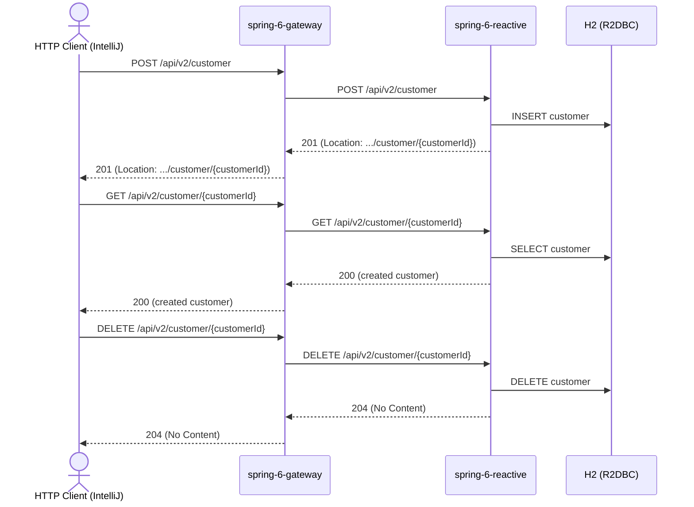

# customer Flow: createCustomer → getCustomer → deleteCustomer

Datei: `restRequests/reactive/customer-flow-create-get-delete/customer-flow-create-get-delete.http`

## Ziel

Einen neuen Kunden anlegen, die erzeugte Ressource per GET prüfen und anschließend wieder löschen.

## Ablauf (Services)

## Requests (in dieser Reihenfolge)

1. `createCustomer` – legt den Kunden an und liest `customerId` aus dem `Location`-Header.
2. `getCustomerById` – prüft, dass der Kunde existiert und `customerName` = `Flow Customer` ist.
3. `deleteCustomer` – löscht den zuvor erzeugten Kunden (hinterlässt keine Testdaten).

## Benötigte Globals

|       Global        |          gesetzt von           |             genutzt von             |
|---------------------|--------------------------------|-------------------------------------|
| `customerId`        | `createCustomer`               | `getCustomerById`, `deleteCustomer` |
| `traceId`, `spanId` | `../../scripts/traceparent.js` | alle Requests                       |

## Asserts

- `createCustomer` → `201` mit `Location`-Header.
- `getCustomerById` → `200`, `customerName` = `Flow Customer`.
- `deleteCustomer` → `204`.

## Hinweise

- Basis-URL ist `{{gateway-port}}` (Profil `local` = 8080, `k8s` = 30080); der Gateway routet `/api/v2/**` an
  `spring-6-reactive` (Port 8082/30082).
- Der `Location`-Header wird vom Reactive-Service als `http://localhost:8082/api/v2/customer/{id}` erzeugt; die ID wird
  über das letzte Pfadsegment extrahiert (der Port im Header ist für die ID-Extraktion irrelevant).
- `customerName` ist Pflicht (`@NotBlank`, 3–255 Zeichen).
- Der Flow ist wiederholbar: Der angelegte Kunde wird am Ende gelöscht.
- Alle Requests benötigen ein Bearer-Token (`auth-id` aus `http-client.env.json`); dafür muss der Auth-Server auf
  Port `9000` laufen (siehe `docker compose up`).

