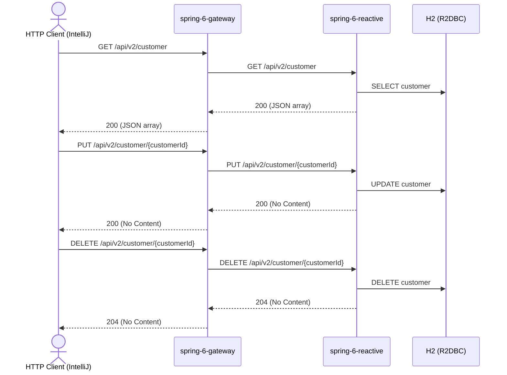

# customer Flow: listCustomers → updateCustomer → deleteCustomer

Datei: `restRequests/reactive/customer-flow-list-update-delete/customer-flow-list-update-delete.http`

## Ziel

Einen bestehenden Kunden aus der Liste auswählen, aktualisieren (PUT) und anschließend löschen.

## Ablauf (Services)

## Requests (in dieser Reihenfolge)

1. `listCustomers` – speichert `customerId` (erster Kunde aus dem JSON-Array).
2. `updateCustomer` – Update (PUT) per `customerId`; das Pre-Request-Skript loggt die benutzte `customerId` und
   wirft einen Fehler, wenn sie nicht gesetzt ist.
3. `deleteCustomer` – löscht den Kunden per `customerId`.

## Benötigte Globals

|       Global        |          gesetzt von           |            genutzt von             |
|---------------------|--------------------------------|------------------------------------|
| `customerId`        | `listCustomers`                | `updateCustomer`, `deleteCustomer` |
| `traceId`, `spanId` | `../../scripts/traceparent.js` | alle Requests                      |

## Asserts

- `listCustomers` → `200`, mindestens ein Kunde.
- `updateCustomer` → `200`.
- `deleteCustomer` → `204`.

## Hinweise

- Basis-URL ist `{{gateway-port}}` (Profil `local` = 8080, `k8s` = 30080); der Gateway routet `/api/v2/**` an
  `spring-6-reactive` (Port 8082/30082).
- Die Collection wird als JSON-Array geliefert (kein HAL, kein `_embedded`).
- `customerName` ist Pflicht (`@NotBlank`, 3–255 Zeichen); `id` und die Timestamps werden vom Server verwaltet und
  nicht im Body gesendet.
- `deleteCustomer` liefert `204 No Content`; bei unbekannter `customerId` `404 Not Found`.
- Ohne vorheriges `listCustomers` ist `customerId` leer → das Pre-Request wirft einen Fehler.
- Alle Requests benötigen ein Bearer-Token (`auth-id` aus `http-client.env.json`); dafür muss der Auth-Server auf
  Port `9000` laufen (siehe `docker compose up`).

