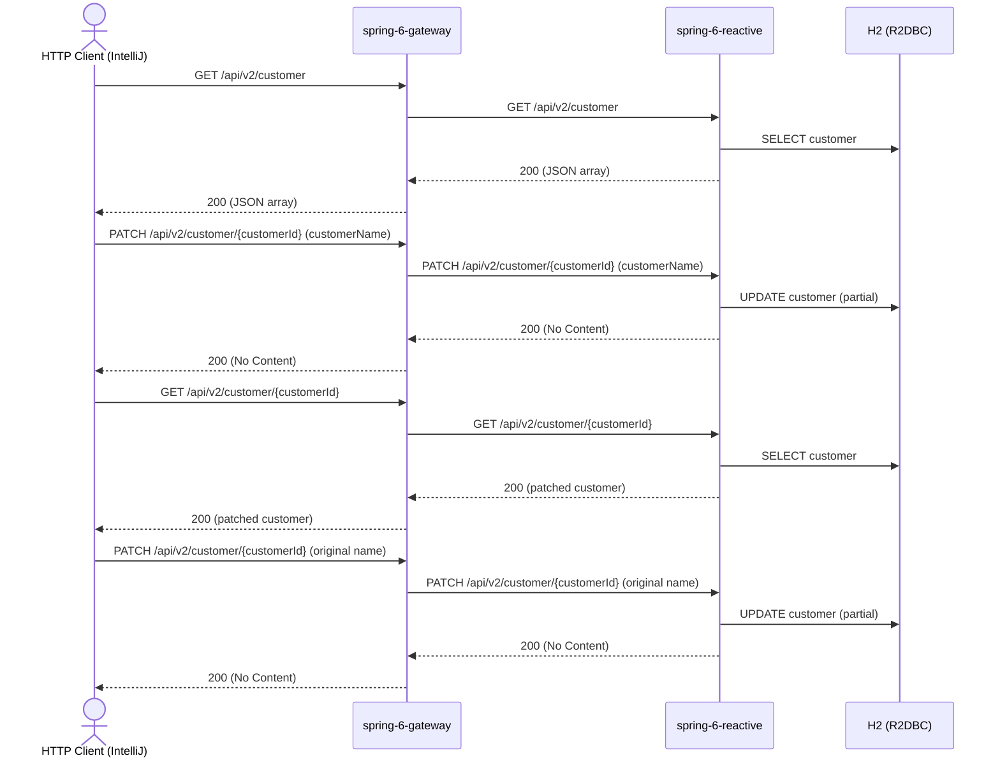

# customer Flow: listCustomers → patchCustomer → verify → restoreCustomer

Datei: `restRequests/reactive/customer-flow-patch/customer-flow-patch.http`

## Ziel

Einen bestehenden Kunden partiell aktualisieren, das Ergebnis per GET prüfen und den ursprünglichen Namen
anschließend wiederherstellen – ohne den Kunden zu löschen.

## Ablauf (Services)

## Requests (in dieser Reihenfolge)

1. `listCustomers` – speichert `customerId` und `originalCustomerName` (erster Kunde aus dem JSON-Array).
2. `patchCustomer` – partielles Update per PATCH.
3. `getCustomerById` – prüft, dass `customerName` geändert wurde.
4. `restoreCustomer` – setzt den ursprünglichen `customerName` per PATCH zurück.

## Benötigte Globals

|         Global         |          gesetzt von           |             genutzt von              |
|------------------------|--------------------------------|--------------------------------------|
| `customerId`           | `listCustomers`                | alle weiteren Requests               |
| `originalCustomerName` | `listCustomers`                | `getCustomerById`, `restoreCustomer` |
| `traceId`, `spanId`    | `../../scripts/traceparent.js` | alle Requests                        |

## Asserts

- `listCustomers` → `200`, mindestens ein Kunde.
- `patchCustomer` → `200`.
- `getCustomerById` → `200`, `customerName` = `Patched Customer`.
- `restoreCustomer` → `200`.

## Hinweise

- Basis-URL ist `{{gateway-port}}` (Profil `local` = 8080, `k8s` = 30080); der Gateway routet `/api/v2/**` an
  `spring-6-reactive` (Port 8082/30082).
- PATCH ist ein partielles Update; das Response-Body ist leer.
- Die Collection wird als JSON-Array geliefert (kein HAL, kein `_embedded`).
- Der Flow löscht keinen Kunden; Schritt 4 stellt den Ausgangszustand wieder her.
- Alle Requests benötigen ein Bearer-Token (`auth-id` aus `http-client.env.json`); dafür muss der Auth-Server auf
  Port `9000` laufen (siehe `docker compose up`).

